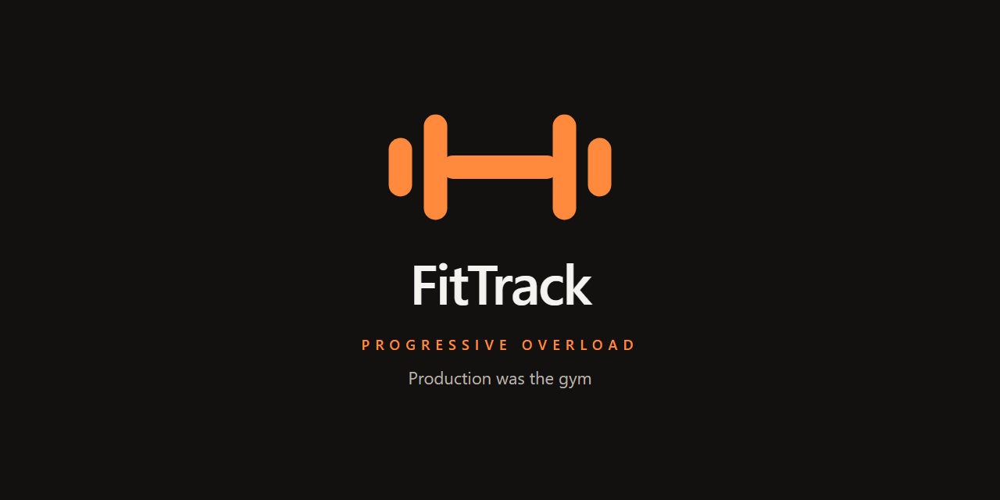

<p align="center">
  
</p>

# FitTrack

[](https://github.com/hugo-burnet/FITTRACK-RELOADED/releases)
[](https://hugo-burnet.github.io/FITTRACK-RELOADED/)
[](docs/ANDROID.md)
[](package.json)

Suivi de musculation personnel. Local-first, hors-ligne, utilisable sans compte, sans fil social.

Un suivi individuel inspiré de Hevy : la salle est un sous-sol sans 4G.

**En ligne :** [hugo-burnet.github.io/FITTRACK-RELOADED](https://hugo-burnet.github.io/FITTRACK-RELOADED/)  
**Téléchargements :** [Releases](https://github.com/hugo-burnet/FITTRACK-RELOADED/releases) — le badge `tag` ci-dessus donne la dernière version publiée.

---

## Ce que c’est

- **Séance en direct** — saisie une main, écriture en base à chaque série validée.
- **Coach vocal** — annonces sérialisées, musique atténuée hors effort, records et récapitulatif de fin.
- **Cadence** — tempo choisi au chrono de la carte d’exercice, préparation dans 10 secondes, 3–2–1, impacts par répétition et passage à l’exercice suivant.
- **Tutoriel oral** — visite initiale facultative et aide contextuelle `?` sur chaque grande page.
- **Routines** — modèles, dossiers, pas de quota.
- **Blocs** — périodisation par intention (`loadIndex` + phase). La routine reste le 100 %. Le Coach tranche sur les perfs, il n’invente pas de permissions.
- **Carte du corps** — les muscles travaillés sur douze semaines ; toucher un muscle donne ses exercices.
- **Historique & records** — 1RM, volume, import CSV Hevy, export CSV / Markdown.
- **Paliers** — 58 seuils écrits à la main, acquis à vie. Aucun compteur qui redescend, aucun objectif affiché avant d'être franchi.
- **Sauvegarde complète** — tout le compte (tables, réglages, préférences) dans un JSON que l’app sait restaurer.
- **PWA et APK** — même code. Capacitor pour Android.

## Ce que ce n’est pas

L’utilisation locale ne demande ni compte ni serveur. Aucun cloud obligatoire,
aucune fonctionnalité sociale. Une clé d’API n’a rien à faire dans le bundle
(`VITE_*` public = public).

Les données vivent dans IndexedDB (Dexie). Désinstaller l’app les efface. Mettre à jour : installer par-dessus, **sans** désinstaller.

## Synchronisation facultative : fonctionnement prévu

**Cette option est en préparation ; elle n’est pas encore disponible dans la
PWA ou l’APK publiés.** Le client est implémenté sur la branche de travail,
sans nouvelle release. Son fonctionnement est le suivant :

| Choix | Compte | Où restent les données ? |
| --- | --- | --- |
| Utilisation locale, choix par défaut | Aucun compte nécessaire | Sur l’appareil ; aucune donnée d’entraînement envoyée au serveur de synchronisation |
| Synchronisation activée explicitement | Compte FitTrack nécessaire | Sur l’appareil et dans l’espace privé de ce compte sur le homelab de l’éditeur |

Le compte sert à identifier le propriétaire des données et à retrouver le même
espace sur plusieurs appareils. Chaque personne aura son propre compte ; elle
se connectera au **même compte sur le téléphone et le PC** pour les synchroniser.
Les autres utilisateurs n’auront pas accès à ses données. Créer un compte ou
se connecter ne vaudra pas, à lui seul, activation de la synchronisation ni
autorisation d’envoyer l’historique local.

L’application reste entièrement utilisable **sans compte**, sans écran de
connexion imposé au lancement. On peut ouvrir **Réglages › Compte et
synchronisation** pour créer son compte plus tard, en conservant les données
déjà présentes. Le serveur privé exige actuellement une invitation. Après
création ou connexion, la synchronisation reste désactivée : sa confirmation
d’activation est une action séparée.

L’option pourra être **activée ou désactivée sur chaque appareil**. Une fois
activée, les données seront envoyées au serveur auto-hébergé de l’éditeur et
les changements récupérés sur les autres appareils ayant activé la sync.
La saisie locale et les séances continueront de fonctionner hors ligne ; les
échanges reprendront au retour du réseau si l’option est toujours active.

Désactiver l’option arrêtera les envois et les réceptions sur l’appareil, qui
conservera ses données et restera utilisable hors ligne. **Cela n’effacera pas
automatiquement les données déjà synchronisées sur le serveur ou les autres
appareils.** La suppression des données serveur devra être une action séparée
et explicite. Avant une réactivation, les changements faits séparément sur
plusieurs appareils devront être vérifiés, sans écrasement silencieux.

Les échanges sont suspendus pendant une séance. Une mise à jour distante
demande son application explicite dans les réglages ; une copie de secours
reste exportable avant un remplacement. Apparence et voix restent propres
à chaque appareil. La restauration d’un fichier local ne réactive jamais
la synchronisation. Les binaires de photos ne sont pas transportés.

## Backend homelab en préparation

La v2.17.4 corrige la compilation sous Windows et ajoute dans le dépôt les
fondations d'un backend de synchronisation auto-hébergé, avec séparation des
comptes et export SQLite cohérent. **La synchronisation APK/PC n'est pas encore
disponible** : l'application reste utilisable hors ligne sans compte, et aucun
backend n'est exposé publiquement. Le backend et l'API de comptes sont installés
dans la VM privée du homelab : **69 tests natifs réussis**, HTTPS et restauration
dans une copie hors ligne vérifiés. L'API permet l'inscription sur invitation
et la connexion/déconnexion sans envoyer de données d'entraînement. Cette
branche ajoute les écrans de compte, l'activation/désactivation par appareil,
le rapprochement prudent et le transport web/Android. L'accès public,
la récupération/MFA, la recette sur téléphone et une release des clients
restent à terminer. Aucun nouvel APK n'est publié par cette installation privée.

Voir [le backend et ses limites](backend/README.md),
[le plan de synchronisation](docs/design/plans/2026-11-06-sync-backend.md) et
[la recette téléphone](docs/recette-telephone.md#mise-a-jour-v2174).

---

## Installer

| Canal | Pour qui | Guide |
| --- | --- | --- |
| PWA | Chrome (Android) / Safari (iOS) | [docs/INSTALLATION.md](docs/INSTALLATION.md) |
| APK signé | Android, hors navigateur | [docs/ANDROID.md](docs/ANDROID.md) |

Un tag `v*` publie l’APK dans une GitHub Release. Pousser `master` seul met à jour Pages, pas la page Releases.

```bash
git push origin master
version="v$(node -p "require('./package.json').version")"
git tag -a "$version" -m "FitTrack $version" && git push origin "$version"
```

---

## Stack

Vite · React 19 · TypeScript strict · Tailwind v4 · Dexie (IndexedDB) · Zustand (état éphémère uniquement) · React Router **hash** · Vitest · Capacitor 8.

Décisions : [docs/plans/01-ARCHITECTURE.md](docs/plans/01-ARCHITECTURE.md).

---

## Développement

```bash
npm install
npm run dev
```

Le `base` Vite suit le nom du dépôt. En local : [http://localhost:5173/FITTRACK-RELOADED/](http://localhost:5173/FITTRACK-RELOADED/).

| Commande | Rôle |
| --- | --- |
| `npm run dev` | Serveur de dev (pas de service worker) |
| `npm run build` | Production (`tsc -b` + Vite) |
| `npm run preview` | Build local, SW inclus |
| `npm run test:run` | Tests, une passe |
| `npm run typecheck` | `tsc --noEmit` |
| `npm run lint` | ESLint |
| `npm run android:sync` | Build web Android + `cap sync` |

Un push sur `master` lance lint, typecheck, tests, build, puis GitHub Pages. Un échec bloque la mise en ligne.

---

## Documentation

| Document | Contenu |
| --- | --- |
| [CLAUDE.md](CLAUDE.md) | Règles non négociables (agents et humains) |
| [docs/plans/00-ROADMAP.md](docs/plans/00-ROADMAP.md) | Lots |
| [docs/plans/01-ARCHITECTURE.md](docs/plans/01-ARCHITECTURE.md) | ADR, modèle |
| [PROGRESS.md](PROGRESS.md) | État réel |
| [docs/journal/](docs/journal/) | Journal des versions livrées (v0.1.0 → v1.3.1) |
| [audit-hevy-cahier-des-charges.md](audit-hevy-cahier-des-charges.md) | Cahier des charges source (`RF-xx`) |
| [docs/design/](docs/design/) | Spécifications et plans d'exécution, par fonctionnalité |

---

## Licence

Usage personnel. Le dépôt n’est pas publié sous une licence open source.

La carte musculaire reprend [Z-Anatomy](licenses/z-anatomy/) (attribution dans ce dossier). La base d’exercices s’appuie sur des jeux de données du domaine public, documentés dans `PROGRESS.md`.
